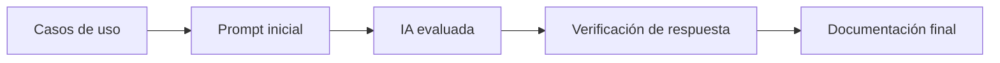

# Evaluación de IA para documentación y resolución de tareas
.


## Tabla de contenidos

- [Descripción del proyecto](#descripción-del-proyecto)
- [Diagrama de flujo de trabajo](#diagrama-de-flujo-de-trabajo)
- [Pregunta 1](#pregunta-1)
- [Pregunta 2](#pregunta-2)
- [Pregunta 3](#pregunta-3)
- [Lista de tareas](#lista-de-tareas)
- [Comparativa de IA](#comparativa-de-ia)
- [Conclusión](#conclusión)

## Descripción del proyecto
 Repositorio del segundo examen, donde se demuestra los resultados de construir prompts efectivos en diferentes herramientas de inteligencia artificial, y el uso de markdowns.

La metodología seguida combina:

- definición de caso de uso real,
- redacción de prompts iniciales,
- refinamiento del prompt final,
- revisión de la salida generada,
- validación y documentación del resultado final.

## Diagrama de flujo de trabajo



## Pregunta 1
### IA: CHAT GPT
### Tabla de componentes prompt

| Componente prompt                       | Ejemplo   | 
|-----------------------------------------|-----------|
| Rol | Ejecutivo |
| Contexto |Problemas frecuentes |
| Tarea | Elaborar un resumen ejecutivo, que indique problemas frecuentes y las acciones a tomar |
| Formato de salida |tabla markdown (el caso no especifica) |
| Restricciones | no inventar problemas, elaborar la tabla basandose unicamente en los datos de entrada |

### Prompt vago
```text
Resume estas reseñas:
1.	"El pedido llegó 50 minutos tarde y la comida fría."
2.	"La app se cerró dos veces al pagar con Yape."
3.	"El repartidor fue muy amable, todo perfecto."
4.	"Tercera vez que mi pedido llega tarde este mes."
5.	"El costo de envío subió a S/ 9, es demasiado."
6.	"No puedo ver el seguimiento del pedido en el mapa, se queda cargando."
7.	"Llegó con una hora de retraso y faltaba una bebida."
8.	"Escribí al chat de soporte y nadie respondió en 2 días."


```

### Prompt estructurado
```text
Rol y contexto:
Eres un ejecutivo de la startup RutaFácil, semanalmente recibimos reseñas de nuestro servicio. 
Tarea y Salida:
Lee las reseñas, y ordenalas en un tabla hecha con markdown, la tabla debe tener las siguientes columnas: Categoría (Las definiras en base a reseñas parecidos), Cantidad (Escribiras la cantidad de problemas por categoría), Ejemplo (Colocaras el resmumen de cada problema de categoría), y por ultimo acciones (Donde escribiras tres acciones que debemos tomar y su justificación)  
Restricciones:
- La salida debe ser solo y unicamente en una tabla hecha con markdown
- La información registrada en la tabla debe basarse estrictamente en lo que esta escrito en la reseñas, no inventes reseñas ni aluicines.

Reseñas:

1.	"El pedido llegó 50 minutos tarde y la comida fría."
2.	"La app se cerró dos veces al pagar con Yape."
3.	"El repartidor fue muy amable, todo perfecto."
4.	"Tercera vez que mi pedido llega tarde este mes."
5.	"El costo de envío subió a S/ 9, es demasiado."
6.	"No puedo ver el seguimiento del pedido en el mapa, se queda cargando."
7.	"Llegó con una hora de retraso y faltaba una bebida."
8.	"Escribí al chat de soporte y nadie respondió en 2 días."


```


### Capturas
#### Prompt vago


#### Prompt especifico


## Pregunta 2
### IA: CLAUDE
### Datos del problema
| Dato                       |              Valor |
| -------------------------- | -----------------: |
| Consultas por día          |              4,000 |
| Días al mes                |                 30 |
| Tokens de entrada actuales | 1,200 por consulta |
| Tokens de salida           |   300 por consulta |
| Precio entrada             |   US$ 3 por millón |
| Precio salida              |  US$ 15 por millón |
| Entrada optimizada         |         700 tokens |
| Presupuesto mensual        |            US$ 900 |

**pasos necesarios parlla llegar a la respuesta**

1. Cantidad de consultas mensuales.
2. Tokens mensuales de entrada y salida.
3. Costo mensual actual.
4. Costo mensual optimizado.
5. Ahorro porcentual.
6. Si cada escenario cumple el presupuesto.

### Prompt directo sin explicaciones

```text
Una empresa llamada EduTech tendrá un chatbot que atenderá 4,000 consultas al día durante 30 días.

Cada consulta usa 1,200 tokens de entrada y 300 de salida. El costo es US$ 3 por millón de tokens de entrada y US$ 15 por millón de tokens de salida.

Hay una propuesta para reducir los tokens de entrada a 700 por consulta, manteniendo los 300 de salida. El presupuesto mensual disponible es de US$ 900.

Calcula el costo mensual actual, el costo mensual optimizado, el porcentaje de ahorro y determina si cada escenario cumple con el presupuesto.

Muestra solo los resultados finales, sin explicar los cálculos.


```

### Prompt analista financiero

```text

Actúa como analista financiero de TI especializado en costos de APIs de LLM.

Datos: [4,000/día, 30/mes, 1200 tokens de entrada y 300 tokens de salida por consulta, precios por millón de tokens = US$ 3 ]

Calcula, primero el escenario actual y luego el optimizado (700 tokens de entrada por consulta):
- Consultas mensuales
- Tokens mensuales de entrada y salida (por separado, convertidos a millones antes de aplicar precios)
- Costo de entrada, de salida y total
- Ahorro mensual en US$ y en % = (actual − optimizado) / actual × 100
- Si cada escenario cumple un presupuesto de US$ 900

Valida todos los cálculos y corrige errores antes de responder.

Entrega:
| Escenario | Tokens de entrada | Tokens de salida | Costo entrada | Costo salida | Costo total | Cumple presupuesto |
y luego las conclusiones dentro de <conclusiones>.

```

### Capturas

#### Prompt directo


#### Prompt analista


## Pregunta 3
### IA: DEEPSEEK
**Esquema JSON ejemplo**
```JSON
{
    nombre:"nombre",
    puesto: "puesto postulacion",
    experiencia: 4, 
    tecnologias:["tecnología","tecnologia"],
    disponibilidad: true,
    pretencion: null

}
```
### Prompt (zero-shot)

```text

Organiza las postolaciones de trabajo enviadas por email en formato JSON.

Postulaciones:
1.	"Buenas tardes, me llamo Rosa Quispe y postulo al puesto de Desarrolladora Backend. Tengo 3 años trabajando con Python y Django, y algo de Docker. Puedo empezar el 1 de diciembre. Mi expectativa es S/ 4,500."
2.	"Hola, soy Diego Ramírez. Me interesa la vacante de Frontend. Llevo año y medio con React y TypeScript. Disponibilidad inmediata."
3.	"Estimados, adjunto mi CV para QA Automation. Mi nombre es Lucía Fernández; 5 años de experiencia con Selenium, Cypress y Java. Pretensión: 6000 soles. Podría incorporarme en dos semanas."


```
### Prompt con ejemplo

```text
Organiza las postolaciones de trabajo enviadas por email en formato JSON.
el JSON debe tener esta estructura:
{
    nombre:"nombre",
    puesto: "puesto postulacio",
    experiencia: float, 
    tecnologias:["tecnología","tecnologia"],
    disponibilidad: bool,
    pretencion: int

}
condiciones:
- coloca null si faltan datos
Postulaciones:
1.	"Buenas tardes, me llamo Rosa Quispe y postulo al puesto de Desarrolladora Backend. Tengo 3 años trabajando con Python y Django, y algo de Docker. Puedo empezar el 1 de diciembre. Mi expectativa es S/ 4,500."
2.	"Hola, soy Diego Ramírez. Me interesa la vacante de Frontend. Llevo año y medio con React y TypeScript. Disponibilidad inmediata."
3.	"Estimados, adjunto mi CV para QA Automation. Mi nombre es Lucía Fernández; 5 años de experiencia con Selenium, Cypress y Java. Pretensión: 6000 soles. Podría incorporarme en dos semanas.
```

### Capturas

#### Prompt zero-shot


#### Prompt con ejemplo


## Lista de tareas

- [x] Definir el objetivo de la evaluación de IA.
- [x] Preparar la estructura del proyecto y el README.
- [x] Diseñar prompts iniciales y finales para cada pregunta.
- [x] Registrar capturas de respuesta en la carpeta img/.
- [x] Realizar comparación entre tres IA.
- [x] Redactar la conclusión final del análisis.
- [x] Documentar los entregables del proyecto.

## Comparativa de IA

| Criterio | GPT-4o | Claude | Deepseek  |
| --- | --- | --- | --- |
| Precisión técnica | Alta | Alta | Media-alta |
| Claridad en la explicación | Muy alta | Alta | Alta |
| Estructura de respuesta | Excelente | Buena | Buena |
| Nivel de detalle | Alto | Alto | Medio |
| Verificación de información | Buena | Buena | Variable |
| Utilidad para documentación | Muy alta | Alta | Media-alta |
| Facilidad de uso | Muy alta | Alta | Muy alta |
| Recomendación general | Excelente para análisis y redacción técnica | Muy bueno para síntesis y contexto | Bueno para apoyo cotidiano y flujo de trabajo |

## Conclusión

Después de evaluar el comportamiento de las tres inteligencias artificiales, se observa que GPT-4o ofrece un equilibrio muy sólido entre precisión, profundidad y claridad, por lo que resulta especialmente útil para análisis técnico y redacción de documentación formal. Claude destaca por su capacidad de síntesis y por responder con un nivel de contexto útil en temas complejos. Deepseekt se muestra muy práctico como asistente integrado en el flujo de trabajo, aunque su nivel de detalle puede ser algo menor cuando se requieren explicaciones más profundas o análisis comparativo más exhaustivo.

En conjunto, la mejor opción depende del caso de uso: para documentación técnica y análisis detallado, GPT-4o suele ser la mejor alternativa; para síntesis y contexto rápido, Claude es muy competitivo; y para trabajo diario apoyado en herramientas de desarrollo, Deepseek aporta gran productividad. El resultado final confirma que la combinación de una IA con buena redacción y una revisión humana sigue siendo la estrategia más sólida para producir materiales precisos y útiles.

---

Proyecto preparado para evidenciar el proceso de evaluación de IA, sus prompts, la verificación de resultados y la documentación final del análisis.
